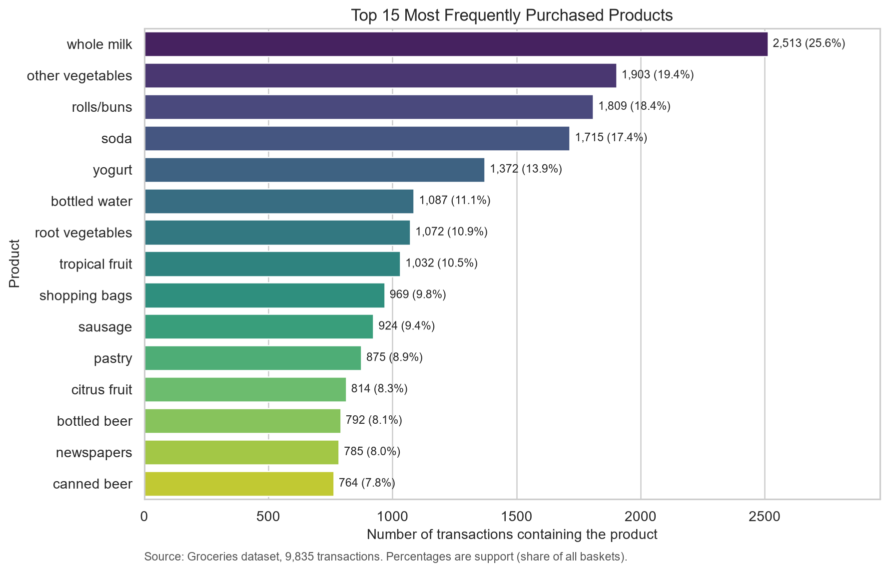
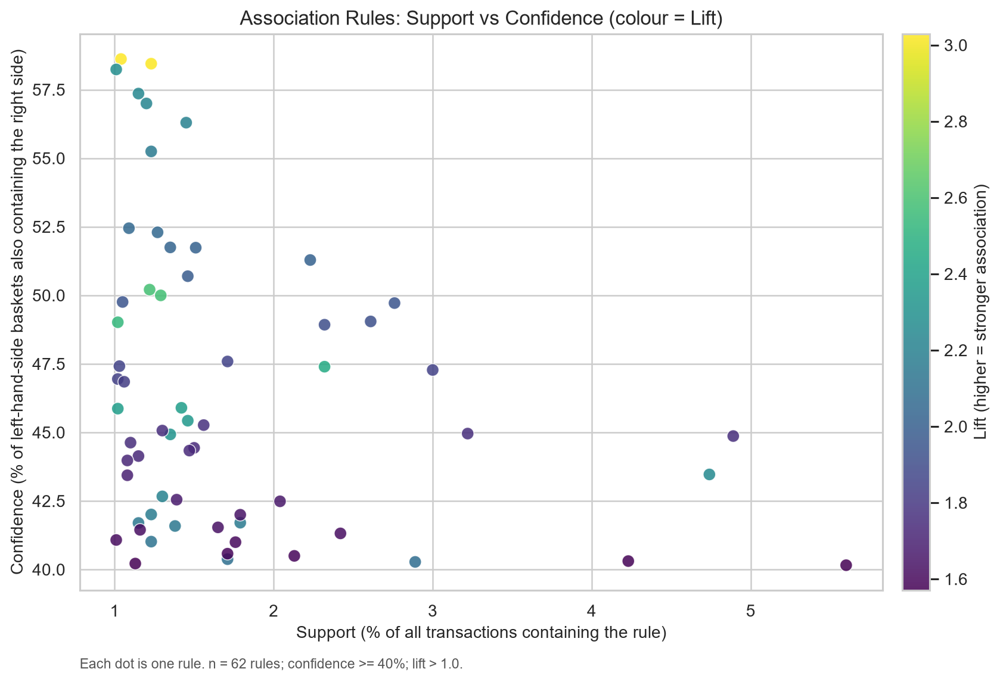
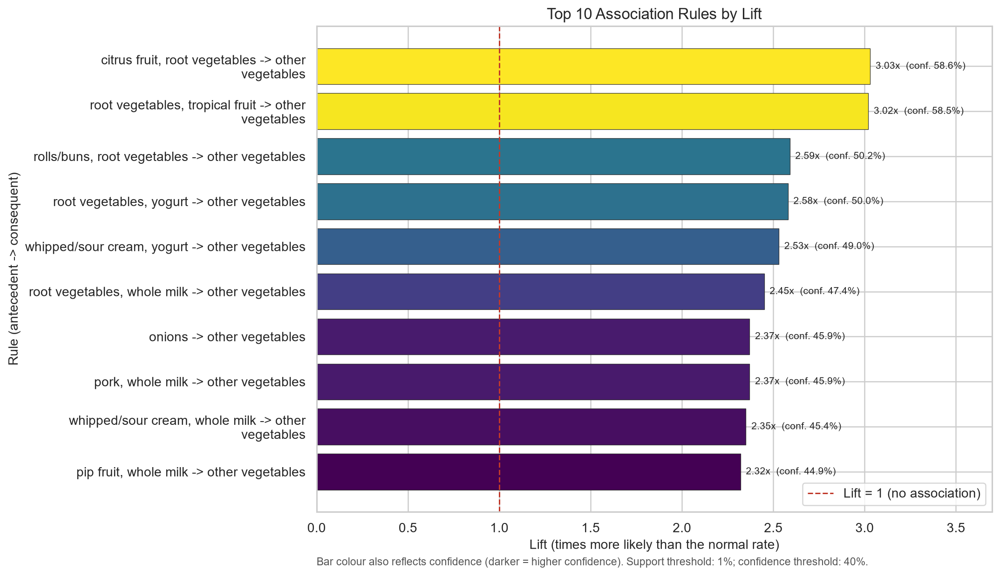

<div align="center">

# 🛒 Market Basket Analysis

### “Customers who bought this also bought…”

A visual, beginner-friendly data-mining project that discovers **which products shoppers buy together**, using the **Apriori** algorithm on 9,835 real grocery baskets.

[](https://www.python.org/)
[](Market_Basket_Analysis.ipynb)
[](https://rasbt.github.io/mlxtend/)

[](#the-dataset)
[](#the-dataset)
[](#results)
[](#results)

**[🌐 Live visual walkthrough](https://rajeshwarshingade.github.io/market-basket-analysis/)** ·
**[📓 Read the notebook](Market_Basket_Analysis.ipynb)** ·
**[📄 Project report](report/Project_Report.pdf)**

</div>

---

## ✨ What is this project?

Imagine you run a small supermarket. You notice that people who buy **pasta** very often also pick up **tomato sauce**. If you knew that for sure, you could:

- place the sauce next to the pasta,
- bundle them in an offer,
- or recommend one when the other is in the cart.

**Market basket analysis** is the technique that finds these patterns automatically. It treats every shopping bill as a *basket* and searches for products that appear together more often than pure chance would predict.

This project does exactly that — end to end:

| Step | What happens |
|---|---|
| 🧺 **Read** | 9,835 real grocery transactions are loaded and cleaned |
| 🔁 **Mine** | The Apriori algorithm finds 333 frequent product combinations |
| 📏 **Score** | Each combination becomes a rule with support, confidence, and lift |
| 📊 **Visualise** | Charts and tables show the strongest patterns |
| 💡 **Explain** | Results are translated into plain business language |

> **One-line answer:** vegetables travel together, dairy follows whole milk, and the strongest signal in the data is that buying *citrus fruit + root vegetables* makes *other vegetables* about **3× more likely** than usual.

---

## 🎯 Results at a glance

<div align="center">

| 🧾 Transactions | 🏷️ Products | 🧩 Frequent itemsets | 🔗 Rules (lift > 1) |
|:---:|:---:|:---:|:---:|
| **9,835** | **169** | **333** | **62** |
| avg. basket **4.41** items | median basket **3** items | min. support **1%** | min. confidence **40%** |

</div>

### 🥇 Most popular products

| # | Product | Baskets | Share |
|:--:|---|---:|---:|
| 1 | 🥛 whole milk | 2,513 | 25.55% |
| 2 | 🥬 other vegetables | 1,903 | 19.35% |
| 3 | 🥖 rolls/buns | 1,809 | 18.39% |
| 4 | 🥤 soda | 1,715 | 17.44% |
| 5 | 🍦 yogurt | 1,372 | 13.95% |

### 🔗 Strongest association rules

| Rule | Support | Confidence | Lift |
|---|---:|---:|---:|
| citrus fruit + root vegetables → **other vegetables** | 1.04% | 58.62% | **3.03** |
| tropical fruit + root vegetables → **other vegetables** | 1.23% | 58.45% | **3.02** |
| rolls/buns + root vegetables → **other vegetables** | 1.22% | 50.21% | **2.59** |
| curd + yogurt → **whole milk** | 1.01% | 58.24% | **2.28** |
| yogurt + whole milk → **other vegetables** | 1.46% | 45.43% | **2.35** |

*Lift of 3.03 means the pair is associated 3× more strongly than random co-occurrence. Full table: [`results/association_rules.csv`](results/association_rules.csv).*

---

## 📐 The three numbers that make a rule

Every rule is written as **`{A} → {B}`** — “if a basket contains A, it probably also contains B.”

| Metric | Plain-English meaning | Example |
|---|---|---|
| **Support** | How common the combination is | `1.04%` of all baskets contain citrus fruit **and** root vegetables |
| **Confidence** | How reliable the “if → then” is | Of baskets with citrus + root vegetables, `58.62%` also had other vegetables |
| **Lift** | How much better than chance | `3.03` → **3×** more likely than if the products were unrelated |

- **Support** answers *“is this worth caring about?”* (too low = rare accident).
- **Confidence** answers *“how often is the prediction right?”*
- **Lift** answers *“is this a real relationship, or just two popular products?”* — the most important one, because popular items appear together anyway.

**Why not just sort by confidence?** A rule like `→ whole milk` can look strong simply because milk is in 25% of baskets. Lift corrects for that popularity bias.

---

## 📊 Charts from the notebook

<div align="center">

**Top products by number of baskets**



**Every rule as a dot — support vs confidence, coloured by lift**



**Top 10 rules by lift**



</div>

More: [basket size distribution](images/01_basket_sizes.png) · [combined report figure](images/05_report_summary.png)

**How to read the scatter plot:** dots to the right occur in many baskets (high support), dots near the top are reliable predictions (high confidence), and brighter dots are stronger associations (high lift). The most *useful* rules sit in the upper-right with a bright colour — the vegetable cluster does exactly that.

---

## ⚙️ How it works

```
raw text baskets
      │  clean names, drop duplicates & empty baskets
      ▼
 list of transactions
      │  one-hot encode (TransactionEncoder)
      ▼
 0/1 basket matrix  ──►  Apriori (min support 1%)  ──►  333 frequent itemsets
      │
      ▼
 association rules (min confidence 40%)  ──►  filter lift > 1  ──►  62 rules
      │
      ▼
 rank by lift · chart · interpret · export CSV/PNG
```

**Apriori in one sentence:** if a combination of items is rare, every larger combination containing it must also be rare — so prune those branches early and only grow the combinations that survive the support threshold.

The notebook implements the association-rule stage with `mlxtend` and includes a **self-contained fallback** so the analysis still runs if the dataset file is missing.

---

## 🚀 Run it yourself

```bash
# 1. get the code
git clone https://github.com/rajeshwarshingade/market-basket-analysis.git
cd market-basket-analysis

# 2. create an environment
python -m venv .venv
# Windows:  .\.venv\Scripts\Activate.ps1
# macOS/Linux: source .venv/bin/activate

# 3. install and launch
pip install -r requirements.txt
jupyter notebook
```

Open **`Market_Basket_Analysis.ipynb`** and choose **Kernel → Restart & Run All**.

The notebook is already executed, so all charts and tables are visible without running anything.

<details>
<summary><b>No dataset? No problem.</b></summary>

`data/groceries.csv` is bundled with the repo. If it is ever missing, the notebook automatically:
- prints a warning,
- falls back to a built-in sample of **40 baskets**,
- raises `min_support` to 15% (1% of 40 baskets is less than one transaction),
- writes the sample to `data/sample_baskets.csv`.

The report numbers always refer to the **full 9,835-basket dataset**, not the fallback.

</details>

<details>
<summary><b>Change the thresholds and see what happens</b></summary>

| Setting | Full dataset | Built-in sample |
|---|---|---|
| `min_support` | 0.01 (≥ 99 baskets) | 0.15 (≥ 6 baskets) |
| `min_confidence` | 0.40 | 0.40 |
| `min_lift` | 1.0 | 1.0 |

Lower support → more rules, including noisy ones. Higher confidence → fewer but safer rules. Try 0.005 and 0.6 in the Apriori cell and compare — it is a great viva demonstration.

</details>

---

## 📁 Project structure

```
market-basket-analysis/
├── index.html                     # 🌐 Visual walkthrough (GitHub Pages)
├── Market_Basket_Analysis.ipynb   # 📓 Main deliverable: full analysis, executed
├── README.md                      # This file
├── requirements.txt               # Python dependencies
├── data/
│   ├── groceries.csv              # 9,835 real transactions
│   └── sample_baskets.csv         # 40-basket backup sample
├── images/                        # Charts generated by the notebook
│   ├── 01_basket_sizes.png
│   ├── 02_top_products.png
│   ├── 03_support_confidence_lift.png
│   ├── 04_top_rules.png
│   └── 05_report_summary.png
├── results/                       # Tables generated by the notebook
│   ├── product_frequencies.csv
│   ├── frequent_itemsets.csv
│   └── association_rules.csv
└── report/
    ├── Project_Report.pdf         # 📄 Three-page formatted report
    ├── Project_Report.md          # Report source
    ├── Project_Report.html        # Print-ready source
    └── Presentation_Outline.md    # 10-slide demo + viva notes
```

---

## 🗃️ The dataset

The **Groceries** dataset is a classic public basket dataset distributed with the R package `arules` and mirrored in the *Machine Learning with R* repository.

- **Download:** <https://raw.githubusercontent.com/stedy/Machine-Learning-with-R-datasets/master/groceries.csv>
- **Path used here:** `data/groceries.csv`
- **Format:** one transaction per line, product names separated by commas
- **Contents:** 9,835 transactions · 169 distinct products · no dates, prices, or customer IDs

```powershell
# download it again (PowerShell)
Invoke-WebRequest `
  -Uri "https://raw.githubusercontent.com/stedy/Machine-Learning-with-R-datasets/master/groceries.csv" `
  -OutFile "data/groceries.csv"
```

---

## 📄 Report & presentation

| File | Use |
|---|---|
| [`report/Project_Report.pdf`](report/Project_Report.pdf) | Ready-to-print three-page report |
| [`report/Project_Report.md`](report/Project_Report.md) | Editable report source |
| [`report/Project_Report.html`](report/Project_Report.html) | Print → Save as PDF after edits |
| [`report/Presentation_Outline.md`](report/Presentation_Outline.md) | 10 slides, demo plan, likely viva questions |

> The report title block still has placeholders (`[Student Name]`, `[College Name]`, …). Fill them in before submitting.

---

## ⚠️ Honest limitations

- The data is an **older, context-free snapshot** — no dates, prices, quantities, customers, or stores.
- Product names are **broad categories** (e.g. “other vegetables”), not individual SKUs.
- Support and confidence thresholds are **business choices**, not universal truths.
- Association is **co-occurrence, not causation** — pasta does not *cause* sauce sales.
- Findings are **not validated** on newer or independent data.

Treat this as a teaching project and a demonstration of method, not a production recommender.

---

## 🧠 Troubleshooting

| Symptom | Fix |
|---|---|
| `ModuleNotFoundError: pandas` / `mlxtend` | Activate the virtual environment, then `python -m ipykernel install --user --name mba-venv`, and select that kernel |
| Charts are blank | Ensure the kernel is running; the notebook sets `%matplotlib inline` |
| “`data/groceries.csv` was not found” | Download it, or accept the built-in 40-basket sample for a quick demo |
| Jupyter opens in the wrong folder | Start Jupyter from the project folder so `data/`, `images/`, `results/` resolve |

---

## 📚 References

1. Agrawal, R., & Srikant, R. (1994). *Fast Algorithms for Mining Association Rules.* VLDB.
2. Tan, P.-N., Steinbach, M., & Kumar, V. *Introduction to Data Mining.* Pearson.
3. [`mlxtend` documentation](https://rasbt.github.io/mlxtend/)
4. [Groceries dataset mirror](https://github.com/stedy/Machine-Learning-with-R-datasets)
5. [R `arules` package](https://cran.r-project.org/package=arules)

---

<div align="center">

**Built as a college minor project by [Rajeshwar Shingade](https://github.com/rajeshwarshingade)**

If this helped you understand association rules, a ⭐ on the repo is appreciated.

<sub>Educational use only. The dataset is public and used here for analysis and teaching.</sub>

</div>
