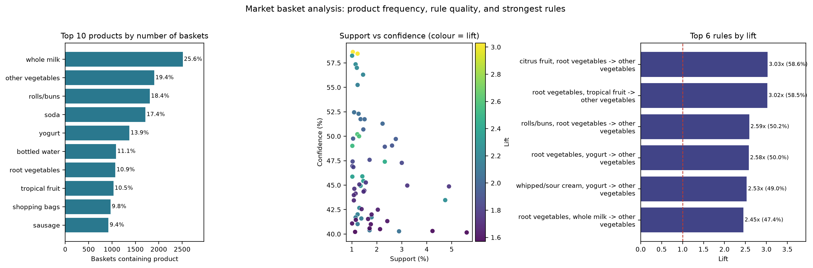

# Market Basket Analysis Using Association Rule Mining

### A Minor Project Report

Submitted in partial fulfilment of the requirements for the minor project

| | |
|---|---|
| **Student** | [Student Name] |
| **Roll number** | [Roll Number] |
| **College** | [College Name] |
| **Department** | [Department Name] |
| **Guide** | [Guide Name] |
| **Academic year** | [Academic Year] |

---

## Abstract

Retail baskets contain patterns: some products are bought together far more often than chance would
suggest. This project applies **market basket analysis** to the public **Groceries** dataset using the
**Apriori algorithm**. The 9,835 baskets and 169 products are cleaned, one-hot encoded, and mined at **1%
minimum support**. Rules are generated with **confidence >= 40%** and **lift > 1**, producing 333 frequent
itemsets and 62 rules. The strongest rule, `{citrus fruit, root vegetables} -> {other vegetables}`, has
support 1.04%, confidence 58.62%, and lift 3.03. The results are visualised and translated into retail
suggestions. The report also explains why association is not causation and why the dataset's age matters.

**Keywords:** market basket analysis, association rule mining, Apriori, support, confidence, lift

---

## 1. Introduction and Objectives

### 1.1 Data mining and market basket analysis

Data mining is the process of finding useful patterns in large datasets. In retail, one of the most direct
patterns is **co-occurrence**: which products appear in the same basket. Market basket analysis, also
called affinity analysis, studies these combinations.

If bread and butter appear together much more often than their individual popularity would predict, a store
can place them near each other, bundle them, or recommend one when the other is selected. Association rule
mining measures and ranks these relationships using support, confidence, and lift.

### 1.2 Problem statement

A store does not automatically know which products form meaningful combinations. The problem is to
identify product sets that occur often enough to matter, generate directional rules, and separate strong
associations from combinations that are common only because both products are popular.

### 1.3 Project objectives

1. Load and clean a public grocery transaction dataset.
2. Describe the data: transactions, products, and basket sizes.
3. Identify the most frequently purchased products.
4. Convert baskets into a one-hot encoded table.
5. Apply Apriori with a clearly explained minimum support.
6. Generate rules using confidence and lift.
7. Rank and display the most useful rules.
8. Explain the metrics with a worked example.
9. Create labelled visualisations and discuss limitations and future scope.

### 1.4 Scope and applications

The project is a **descriptive co-occurrence analysis** of one public dataset. It does not use prices,
margins, quantities, customer IDs, dates, or store locations. It is an educational study, not a production
recommendation system. Practical uses include product placement, meal bundles, targeted promotions,
online recommendations, and testing store layouts.

---

## 2. Dataset and Methodology

### 2.1 Dataset source and description

The project uses the **Groceries** dataset, distributed with the R package `arules` and mirrored in the
*Machine Learning with R* repository on GitHub
(<https://github.com/stedy/Machine-Learning-with-R-datasets>). Each line of `groceries.csv` is one basket,
with products separated by commas.

**Computed description:** 9,835 transactions, 169 distinct products, average basket size **4.41**, median
**3**, maximum **32**, and 2,159 single-item baskets (22.0%). The data are an older public snapshot,
widely described as 1990s grocery transactions. The file has no date field, so the exact period cannot be
verified. It also lacks prices, quantities, customer IDs, stores, and promotion flags.

### 2.2 Data cleaning and preprocessing

Each line is treated as one basket. The notebook strips whitespace, converts names to lowercase, removes
empty and missing-like tokens (`nan`, `none`, `null`), removes duplicate products inside a basket, and
drops empty baskets.

On the full file, these checks found **no blank rows, no missing-like tokens, and no duplicate items**;
all 9,835 baskets were valid. The cleaning code is retained because real retail files are rarely tidy.
**Single-item baskets are kept:** they are real purchases and affect support. They cannot form a pair
themselves, but removing them would inflate the support of every pair.

### 2.3 Explanation of Apriori

Apriori finds frequent itemsets in stages. It counts single products, keeps those above minimum support,
joins them into pairs, counts the pairs, and continues with larger sets. It uses the **Apriori principle**:
if an itemset is infrequent, every larger itemset containing it must also be infrequent, so those
candidates are skipped. This makes the search practical.

The minimum support is **1%**, so an itemset must appear in at least `ceil(0.01 x 9,835) = 99` baskets.
This is a business choice: low enough to find useful pairs, high enough to avoid thousands of one-off
combinations.

### 2.4 Support, confidence, and lift

For a rule **A -> B**:

- **Support** = baskets containing both A and B / all baskets.
- **Confidence** = baskets containing both / baskets containing A = P(B | A).
- **Lift** = confidence / support(B) = P(B | A) / P(B).

Lift = 1 means no association beyond the baseline; lift > 1 means B is more likely when A is present;
lift < 1 means they appear together less often than expected.

**Worked example (computed):** for `root vegetables -> other vegetables`, 1,072 baskets contain root
vegetables, 1,903 contain other vegetables, and 466 contain both. Support = 466 / 9,835 = **4.74%**;
confidence = 466 / 1,072 = **43.47%**; lift = 43.47% / 19.35% = **2.25**. So 43.5% of root-vegetable
baskets also contain other vegetables, 2.25 times the normal rate.

### 2.5 Tools and workflow

**Tools:** Python 3, Jupyter Notebook, pandas, NumPy, mlxtend, Matplotlib, and Seaborn.

**Workflow:** download the CSV -> read and clean baskets -> describe the data -> one-hot encode -> run
Apriori at 1% support -> generate rules at 40% confidence and lift > 1 -> sort and visualise -> interpret
and discuss limitations.

**Figure 1.** Main outputs: product frequency (left), support vs confidence (middle), and strongest rules
(right). Full-size versions are in the notebook.

---

## 3. Results, Conclusion, and Future Scope

> **Computed findings:** the numbers below come from running the notebook on the full 9,835-transaction
> dataset with 1% support, 40% confidence, and lift > 1. They are measured, not estimated.

### 3.1 Key findings

- **Whole milk** is the most frequent product: 2,513 baskets (**25.55%**), then other vegetables (1,903;
  **19.35%**), rolls/buns (1,809; **18.39%**), soda (1,715; **17.44%**), and yogurt (1,372; **13.95%**).
- Apriori found **333 frequent itemsets**; filtering left **62 rules**. The strongest rules are vegetable
  combinations.

### 3.2 Selected association rules

| Rule | Support | Confidence | Lift |
|---|---:|---:|---:|
| `{citrus fruit, root vegetables} -> other vegetables` | 1.04% | 58.62% | 3.03 |
| `{root vegetables, tropical fruit} -> other vegetables` | 1.23% | 58.45% | 3.02 |
| `{rolls/buns, root vegetables} -> other vegetables` | 1.22% | 50.21% | 2.59 |
| `{yogurt, root vegetables} -> other vegetables` | 1.29% | 50.00% | 2.58 |
| `{root vegetables, whole milk} -> other vegetables` | 2.32% | 47.40% | 2.45 |
| `{curd, yogurt} -> whole milk` | 1.01% | 58.24% | 2.28 |

The first rule: 1.04% of baskets contain all three products; among baskets with citrus fruit and root
vegetables, 58.62% also contain other vegetables, 3.03 times baseline. `yogurt -> whole milk` is more
common (5.60% support) but weaker (lift 1.57).

### 3.3 Explanation of charts

Figure 1 (page 2) summarises the three labelled charts, and full-size versions are in the notebook. The
**top-products bar chart** shows whole milk leading at 25.55%, followed by other vegetables (19.35%) and rolls/buns (18.39%). The **support-confidence scatter
plot** places each rule at its support and confidence, with colour showing lift; the upper-right area is
ideal, but the most common rules are not the brightest. The **top-rules bar chart** ranks the six strongest
rules by lift, all above 2.2. Every chart has labelled axes and a source note.

### 3.4 Interpretation and retail use

- **Vegetables cluster.** Group root vegetables, citrus fruit, tropical fruit, and onions near other
  vegetables; test a "vegetable curry pack".
- **Dairy supports milk.** Curd, yogurt, butter, and sour cream have lift 1.8-2.3 with milk; use a shared
  chilled aisle or breakfast bundle. Because milk is already in one in four baskets, discount a
  complementary item rather than milk, and recommend other vegetables after root vegetables and citrus
  fruit (lift 3.03).

### 3.5 Conclusion

The project demonstrates a complete association rule mining workflow. Vegetables and dairy products
co-occur in meaningful ways, and some rules are about three times stronger than baseline. However, broad categories
hide SKU-level detail and association is not causation, so changes should be tested with a controlled
experiment.

### 3.6 Limitations

1. **Age and missing context:** no dates, prices, quantities, customer IDs, or promotions.
2. **Broad categories and thresholds:** `other vegetables` is a category, not a specific product, and 1%
   support plus 40% confidence change which rules appear.
3. **Association is not causation:** lift does not prove that buying A makes a customer buy B, and the
   results are not validated on a newer dataset.

### 3.7 Future improvements

Add prices and margins, use newer data, try FP-Growth, add stability checks, and test bundles or layouts
with A/B experiments.

---

## References

1. Agrawal, R., & Srikant, R. (1994). *Fast Algorithms for Mining Association Rules.* VLDB.
2. Tan, P.-N., Steinbach, M., & Kumar, V. *Introduction to Data Mining.* Pearson.
3. `mlxtend` documentation: <https://rasbt.github.io/mlxtend/>
4. Groceries dataset mirror: <https://github.com/stedy/Machine-Learning-with-R-datasets>
5. R `arules` package: <https://cran.r-project.org/package=arules>
